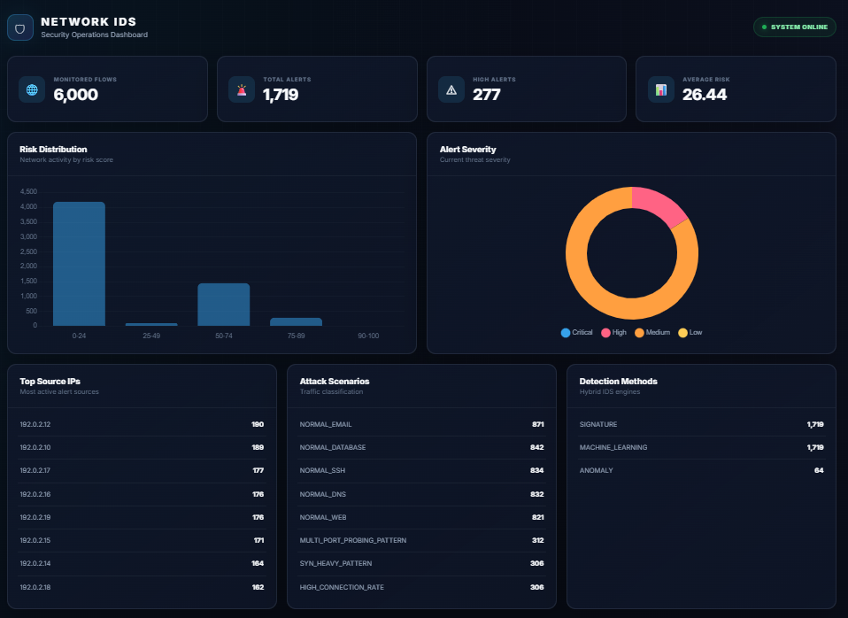
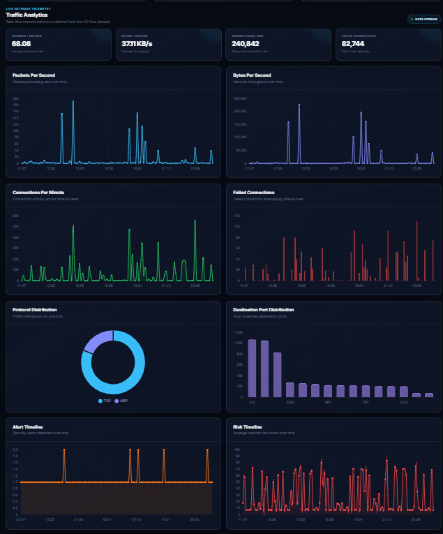
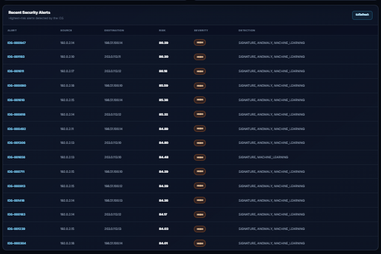
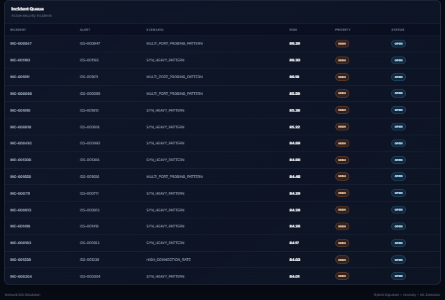

# 🛡️ Network IDS Simulation
### Hybrid Network Intrusion Detection & Security Operations Dashboard

> A modular, SOC-style Network Intrusion Detection System (IDS) simulation that combines signature-based detection, anomaly detection, machine learning, hybrid risk scoring, alert generation, incident management, and analyst investigation into a unified FastAPI + web dashboard workflow.

---

## 1. Executive Summary

**Network IDS Simulation** is a defensive cybersecurity project designed to demonstrate how multiple detection techniques can be integrated into a single network-security monitoring pipeline.

Instead of depending on one detection mechanism, the system evaluates network-flow behaviour through three complementary detection layers:

- **Signature-based detection** for known and rule-defined suspicious patterns.
- **Anomaly detection** for deviations from established normal traffic behaviour.
- **Machine-learning detection** for learned network-flow classifications.

The outputs of these detection layers are passed to a **hybrid risk engine**, which produces a consolidated risk score and severity decision. Suspicious activity can then become an alert, enter incident management, and be investigated through a browser-based analyst dashboard.

The project therefore demonstrates an end-to-end defensive workflow:

```text
Network Traffic
      │
      ▼
Traffic Simulation / Flow Input
      │
      ▼
Feature Extraction
      │
      ├──────────────┬──────────────┐
      ▼              ▼              ▼
 Signature       Anomaly           ML
 Detection       Detection      Detection
      │              │              │
      └──────────────┴──────────────┘
                     │
                     ▼
              Hybrid Risk Engine
                     │
                     ▼
             Risk / Severity / Decision
                     │
                     ▼
               Alert Generation
                     │
                     ▼
             Incident Management
                     │
                     ▼
               FastAPI Backend
                     │
                     ▼
              Analyst Dashboard
                     │
                     ▼
              Investigation Workflow
                     │
              ┌──────┴──────┐
              ▼             ▼
          Resolved      False Positive
```

---

# 2. Problem Statement

Traditional single-layer detection approaches can struggle when network activity does not exactly match a known signature or when legitimate traffic exhibits unusual characteristics.

A practical detection workflow should therefore be capable of:

1. Detecting known suspicious patterns.
2. Identifying deviations from normal traffic.
3. Applying learned classification models.
4. Combining multiple detection signals.
5. Prioritizing events according to risk.
6. Presenting alerts in an analyst-friendly interface.
7. Supporting investigation and incident status management.

This project addresses these requirements through a simulated hybrid IDS architecture.

---

# 3. Project Objectives

### Primary objectives

- Build a modular network-flow processing pipeline.
- Generate and process simulated network traffic.
- Extract security-relevant network features.
- Implement rule/signature-based detection.
- Implement anomaly-based detection.
- Implement machine-learning-based detection.
- Combine detector outputs through a hybrid risk engine.
- Generate structured security alerts.
- Manage security incidents.
- Provide analyst investigation and status workflows.
- Expose the system through FastAPI.
- Visualize security information through a web dashboard.

### Engineering objectives

- Keep detection modules independently testable.
- Store intermediate and final results in reproducible files.
- Separate configuration from application logic.
- Preserve ML artifacts and evaluation results.
- Provide a clear repository structure suitable for Git/GitHub.

---

# 4. Key Capabilities

| Capability | Purpose |
|---|---|
| Traffic Simulation | Generate controlled network-flow scenarios |
| Feature Extraction | Convert traffic into detection-ready features |
| Signature Detection | Identify known/rule-defined patterns |
| Anomaly Detection | Identify deviations from normal behaviour |
| ML Detection | Classify network flows using a trained model |
| Hybrid Risk Engine | Consolidate multiple detection signals |
| Alert Generation | Produce structured security alerts |
| Incident Management | Group and manage security events |
| Dashboard | Provide analyst-facing visibility |
| Investigation | Inspect and process individual alerts |
| Status Workflow | Track analyst handling of events |
| Evaluation | Measure IDS/model performance |
| REST API | Expose backend functionality |

---

# 5. Detection Strategy

## 5.1 Signature-Based Detection

The rule engine evaluates flow characteristics against configured detection rules.

### Strengths

- Deterministic.
- Fast.
- Explainable.
- Effective for known patterns.

### Limitation

A signature-based approach can miss previously unseen or substantially modified behaviours that do not satisfy existing rules.

### Implementation

```text
ids/rule_engine.py
```

### Configuration

```text
config/detection_rules.json
```

### Output

```text
data/rule_detection_results.csv
```

---

# 6. Anomaly Detection

The anomaly layer evaluates behavioural deviations from a normal traffic baseline.

The project maintains a baseline in:

```text
data/normal_traffic_baseline.json
```

and implements anomaly processing through:

```text
ids/anomaly_detector.py
```

### Example behavioural dimensions

- Packet rate.
- Byte rate.
- Connection rate.
- Failed connection ratio.
- SYN behaviour.
- RST behaviour.
- Destination diversity.
- Source behaviour.

### Output

```text
data/anomaly_detection_results.csv
```

---

# 7. Machine Learning Detection

The ML layer uses a trained **Random Forest** classifier to identify network-flow patterns.

### Model artifact

```text
models/random_forest_ids.joblib
```

### Model metrics

```text
models/random_forest_metrics.json
```

### Implementation

```text
ids/ml_detector.py
```

### Recorded model configuration

```text
Algorithm              Random Forest
Estimators             200
Maximum Depth          12
Minimum Samples Leaf   2
Random State            42
```

### Stored evaluation

```text
Accuracy      0.99917
Precision     0.99723
Recall        1.00000
F1 Score      0.99861
ROC-AUC       0.99991
```

These values are the recorded project evaluation results and should be interpreted in the context of the generated dataset and evaluation methodology.

---

# 8. Feature Engineering

The primary feature dataset is:

```text
data/network_features.csv
```

Current dataset size:

```text
6,000 flows
29 columns
```

### Core traffic features

```text
packet_count
byte_count
duration_seconds
connection_count
failed_connection_count
syn_count
rst_count
average_packet_size
```

### Derived behavioural features

```text
packets_per_second
bytes_per_second
calculated_average_packet_size
connection_rate
failed_connection_ratio
syn_ratio
rst_ratio
unique_destination_ports
unique_destination_ips
unique_source_ports
source_flow_count
source_failed_flow_count
```

### Why derived features matter

Raw packet and byte counts provide volume information, while rate and ratio features capture behavioural characteristics. Combining both allows the detection layers to distinguish different traffic patterns more effectively.

---

# 9. Hybrid Risk Engine

The system combines the outputs of the detection layers rather than treating any single detector as authoritative.

Configured weighting:

```text
Signature Detection       35%
Anomaly Detection         30%
Machine Learning          35%
```

Implementation:

```text
ids/risk_engine.py
```

Configuration:

```text
config/risk_config.json
```

The resulting risk assessment is used to determine:

- Risk score.
- Severity.
- Decision.
- Risk explanation.
- Alert priority.

---

# 10. Severity Model

The configured severity model uses risk thresholds:

| Risk Score | Severity |
|---:|---|
| Below 25 | LOW |
| 25–49 | LOW |
| 50–74 | MEDIUM |
| 75–89 | HIGH |
| 90–100 | CRITICAL |

The authoritative project configuration is:

```text
config/risk_config.json
```

---

# 11. Alert Generation

The alert layer converts suspicious detection results into structured security events.

Implementation:

```text
ids/alert_generator.py
```

Primary output:

```text
data/alerts.csv
```

Alert information includes fields such as:

- Flow identifier.
- Timestamp.
- Source and destination information.
- Protocol and ports.
- Detection scores.
- Risk score.
- Severity.
- Decision.
- Matched rules.
- Detection classifications.
- Risk explanation.

---

# 12. Incident Management

Alerts can be represented and managed as incidents for analyst investigation.

Implementation:

```text
ids/incident_manager.py
```

Incident output:

```text
data/incidents.csv
```

This creates a bridge between automated detection and analyst response.

---

# 13. Analyst Investigation Workflow

The dashboard supports a structured analyst status lifecycle:

```text
NEW
 │
 ▼
INVESTIGATING
 │
 ▼
RESOLVED
```

The system also supports:

```text
FALSE_POSITIVE
```

The workflow provides a simple operational model:

- **NEW** — event has been generated and requires review.
- **INVESTIGATING** — analyst is actively examining the event.
- **RESOLVED** — investigation has been completed.
- **FALSE_POSITIVE** — event was determined not to represent a meaningful security incident.

---

# 14. Backend Architecture

The backend is implemented using **FastAPI**.

Main application:

```text
api/main.py
```

The backend provides API functionality for:

- Health status.
- Dashboard summary.
- Alerts.
- Incidents.
- Network information.
- Risk distribution.
- Traffic analytics.
- Flow submission.
- Investigation/status operations.

### API documentation

When the backend is running:

```text
http://127.0.0.1:8000/docs
```

FastAPI's OpenAPI interface can be used to inspect and manually exercise the available endpoints.

---

# 15. Frontend Architecture

The dashboard is implemented using:

```text
frontend/
├── index.html
├── style.css
└── app.js
```

The frontend communicates with the FastAPI backend through HTTP APIs.

### Dashboard responsibilities

- Display security overview.
- Visualize traffic.
- Display alerts.
- Show risk distribution.
- Display incidents.
- Open investigation details.
- Reflect analyst status workflow.

---

# 16. Data & Result Artifacts

The project preserves intermediate and final artifacts under `data/`.

Important files include:

```text
data/
├── alerts.csv
├── anomaly_detection_results.csv
├── confusion_matrix.csv
├── evaluation_metrics.json
├── hybrid_risk_results.csv
├── incidents.csv
├── ml_detection_results.csv
├── network_features.csv
├── network_traffic.csv
├── normal_traffic_baseline.json
├── rule_detection_results.csv
└── scenario_metrics.csv
```

This structure allows individual detection stages to be inspected without requiring the entire pipeline to be rerun.

---

# 17. Evaluation

The stored IDS evaluation reports:

```text
Total flows       : 6000
Benign flows      : 4200
Attack flows      : 1800

Accuracy          : 98.65%
Precision         : 100%
Recall            : 95.5%
F1 Score          : 97.70%

False positives   : 0
Detected attacks  : 1719
Missed attacks    : 81
```

### Interpretation

The recorded evaluation indicates strong detection performance on the project's generated evaluation dataset. The zero false-positive result is useful for the controlled demonstration, while the 81 missed attacks demonstrate that detection is not perfect and that recall remains an important metric.

The results should not be interpreted as production-grade performance because the system is evaluated on simulated/generated traffic rather than a representative enterprise network.

---

# 18. Confusion Matrix & Scenario Analysis

Additional evaluation artifacts:

```text
data/confusion_matrix.csv
data/scenario_metrics.csv
```

These files provide additional visibility into classifier/detector behaviour across evaluated scenarios.

---

# 19. Project Structure

```text
Network-IDS-Simulation/
│
├── api/
│   └── main.py
│
├── config/
│   ├── alert_config.json
│   ├── detection_rules.json
│   ├── incident_config.json
│   └── risk_config.json
│
├── data/
│   ├── alerts.csv
│   ├── anomaly_detection_results.csv
│   ├── confusion_matrix.csv
│   ├── evaluation_metrics.json
│   ├── hybrid_risk_results.csv
│   ├── incidents.csv
│   ├── ml_detection_results.csv
│   ├── network_features.csv
│   ├── network_traffic.csv
│   ├── normal_traffic_baseline.json
│   ├── rule_detection_results.csv
│   └── scenario_metrics.csv
│
├── ids/
│   ├── alert_generator.py
│   ├── anomaly_detector.py
│   ├── evaluate_ids.py
│   ├── feature_extractor.py
│   ├── incident_manager.py
│   ├── ml_detector.py
│   ├── risk_engine.py
│   └── rule_engine.py
│
├── models/
│   ├── random_forest_ids.joblib
│   └── random_forest_metrics.json
│
├── simulator/
│   ├── generate_dataset.py
│   ├── live_simulator.py
│   └── traffic_simulator.py
│
├── frontend/
│   ├── app.js
│   ├── index.html
│   └── style.css
│
├── backend/
├── docs/
├── ml/
├── reports/
├── tests/
├── screenshots/
│
├── .gitignore
├── requirements.txt
└── README.md
```

The documentation/support directories are being organized as part of the repository-completion phase.

---

# 20. Installation

## Windows

Create a virtual environment:

```powershell
python -m venv venv
```

Activate it:

```powershell
.\venv\Scripts\Activate.ps1
```

Install dependencies:

```powershell
pip install -r requirements.txt
```

---

# 21. Start the Backend

From the project root:

```powershell
uvicorn api.main:app --reload
```

Expected base address:

```text
http://127.0.0.1:8000
```

Open API documentation:

```text
http://127.0.0.1:8000/docs
```

---

# 22. Start the Frontend

Open another terminal from the project root:

```powershell
python -m http.server 5500 --directory frontend
```

Open:

```text
http://localhost:5500
```

---

# 23. Development Workflow

A typical development workflow is:

```text
1. Generate or simulate traffic
        ↓
2. Extract network features
        ↓
3. Execute signature detection
        ↓
4. Execute anomaly detection
        ↓
5. Execute ML detection
        ↓
6. Combine detector results
        ↓
7. Calculate hybrid risk
        ↓
8. Generate alerts
        ↓
9. Create/manage incidents
        ↓
10. Expose results through FastAPI
        ↓
11. Display results on dashboard
        ↓
12. Investigate and update status
```

---

# 24. Testing Strategy

The project should test both individual detection components and their integration.

Recommended coverage areas:

```text
Feature Extraction
Signature Detection
Anomaly Detection
ML Prediction
Risk Calculation
Alert Generation
Incident Management
API Endpoints
Status Workflow
Dashboard/API Integration
```

Run the test suite with:

```powershell
pytest -v
```

Test results should be recorded from the actual execution environment rather than manually fabricated.

---

# 25. Security & Defensive Use

This project is intended for:

- Defensive cybersecurity education.
- Controlled IDS experimentation.
- Network-security research.
- SOC workflow demonstration.
- Academic project evaluation.

Only use generated traffic, test traffic, and security testing techniques in environments where you have authorization.

Do not commit:

- Passwords.
- API keys.
- Private keys.
- Tokens.
- Production credentials.
- Sensitive network information.

The repository `.gitignore` is configured to exclude common environment and secret files.

---

# 26. Limitations

This project is a **Network IDS simulation**.

It should not be represented as a production-grade enterprise IDS.

Current limitations include:

1. Traffic is simulated/generated rather than captured directly from a production network.
2. ML performance depends on the generated dataset and feature distribution.
3. Detection rules are limited to the configured rule set.
4. The anomaly baseline represents the project's controlled environment.
5. Real enterprise traffic can contain substantially greater protocol and behavioural diversity.
6. The dashboard is intended as a demonstration/analyst interface rather than a hardened production SOC platform.
7. No claim is made that the recorded evaluation metrics generalize to unseen real-world networks.

---

# 27. Future Enhancements

Potential extensions include:

### Network Visibility

- PCAP ingestion.
- Live packet capture.
- Network-interface sensors.
- Flow collection from distributed endpoints.

### Detection

- Additional attack categories.
- Deep-learning models.
- Ensemble learning.
- Online/incremental learning.
- Concept-drift detection.
- Automated threshold calibration.

### Threat Intelligence

- IOC enrichment.
- Threat-intelligence feeds.
- Reputation services.
- MITRE ATT&CK mapping.

### SOC Integration

- SIEM integration.
- Case management.
- Analyst notes.
- Role-based access control.
- Authentication.
- Audit logging.
- Notification integrations.

### Deployment

- Docker.
- Kubernetes.
- Cloud deployment.
- Distributed detection sensors.
- Centralized event processing.

---

# 28. Responsible Interpretation of ML Results

The high recorded ML metrics demonstrate that the model performs strongly on the project's evaluation data.

However:

> High benchmark performance on a generated dataset does not automatically imply equivalent performance on real enterprise traffic.

A production evaluation should include:

- Independent test data.
- Temporal validation.
- Class imbalance analysis.
- Realistic benign traffic.
- Multiple attack families.
- False-positive analysis.
- Drift monitoring.
- External validation datasets.

This distinction is important when presenting the project academically or technically.

---

# 29. Reproducibility

The repository retains important artifacts needed to understand the demonstrated results:

```text
data/
models/
config/
ids/
simulator/
api/
frontend/
```

The generated datasets, configuration files, model artifact, evaluation outputs, and source modules provide traceability between the detection pipeline and its stored results.

---

# 30. Project Status

### Implementation

- [x] Project foundation
- [x] Traffic simulation
- [x] Feature extraction
- [x] Signature detection
- [x] Anomaly detection
- [x] Machine learning detection
- [x] Hybrid risk engine
- [x] Alert generation
- [x] Incident management
- [x] FastAPI backend
- [x] Dashboard
- [x] Traffic analytics
- [x] Investigation workflow
- [x] Analyst status workflow
- [x] End-to-end demonstration

### Repository completion

- [x] `.gitignore`
- [ ] `README.md`
- [ ] `docs/`
- [ ] `ml/`
- [ ] `reports/`
- [ ] `tests/`
- [ ] `screenshots/`

The repository-completion items are being finalized separately from the core implementation.
---
## Dashboard Screenshots

### Dashboard Overview


### Traffic Analytics


### Recent Security Alerts


### Incident Queue

---

# 31. Author

**Khadergouse Savanur**

**Project:** Network IDS Simulation

**Focus:** Network Security • Intrusion Detection • Machine Learning • SOC Workflow • FastAPI • Security Analytics

---

## ⭐ Final Architecture

```text
┌───────────────────────────────────────────────────────────────┐
│                    NETWORK IDS SIMULATION                     │
├───────────────────────────────────────────────────────────────┤
│                                                               │
│  Traffic Simulator / Flow Input                              │
│                    │                                          │
│                    ▼                                          │
│             Feature Extraction                               │
│                    │                                          │
│       ┌────────────┼────────────┐                             │
│       ▼            ▼            ▼                             │
│   Signature     Anomaly        ML                            │
│   Detection     Detection   Detection                        │
│       │            │            │                             │
│       └────────────┼────────────┘                             │
│                    ▼                                          │
│             Hybrid Risk Engine                               │
│                    │                                          │
│                    ▼                                          │
│            Risk + Severity + Decision                         │
│                    │                                          │
│                    ▼                                          │
│              Alert Generation                                │
│                    │                                          │
│                    ▼                                          │
│             Incident Management                              │
│                    │                                          │
│                    ▼                                          │
│                FastAPI                                        │
│                    │                                          │
│                    ▼                                          │
│             Security Dashboard                               │
│                    │                                          │
│                    ▼                                          │
│              Analyst Investigation                           │
│                    │                                          │
│          ┌─────────┴─────────┐                                │
│          ▼                   ▼                                │
│       RESOLVED          FALSE_POSITIVE                        │
│                                                               │
└───────────────────────────────────────────────────────────────┘
```

---

**Network IDS Simulation — Defensive Security Analytics & Detection Engineering**
